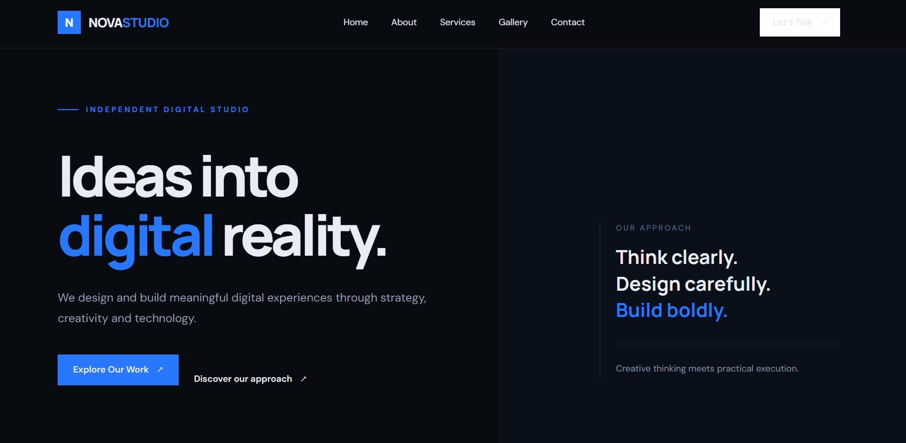
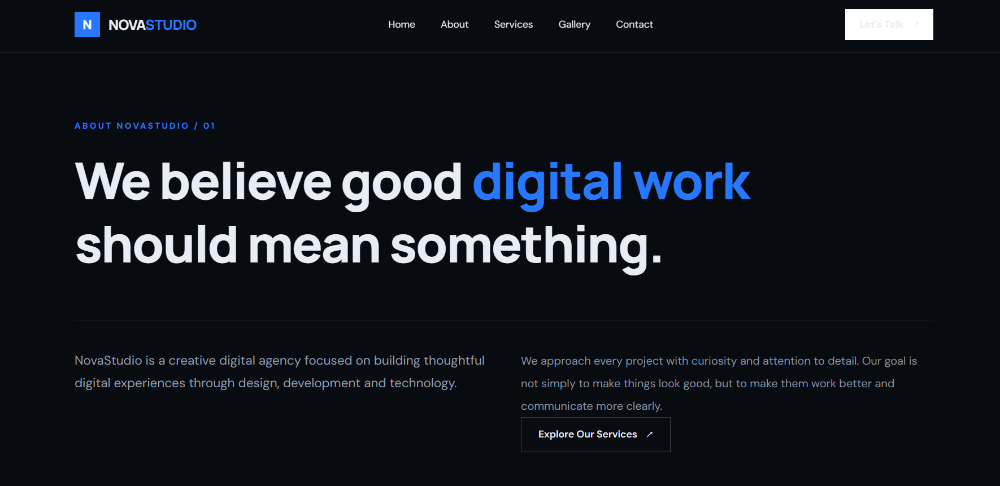
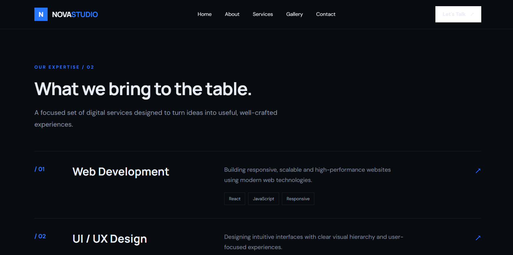
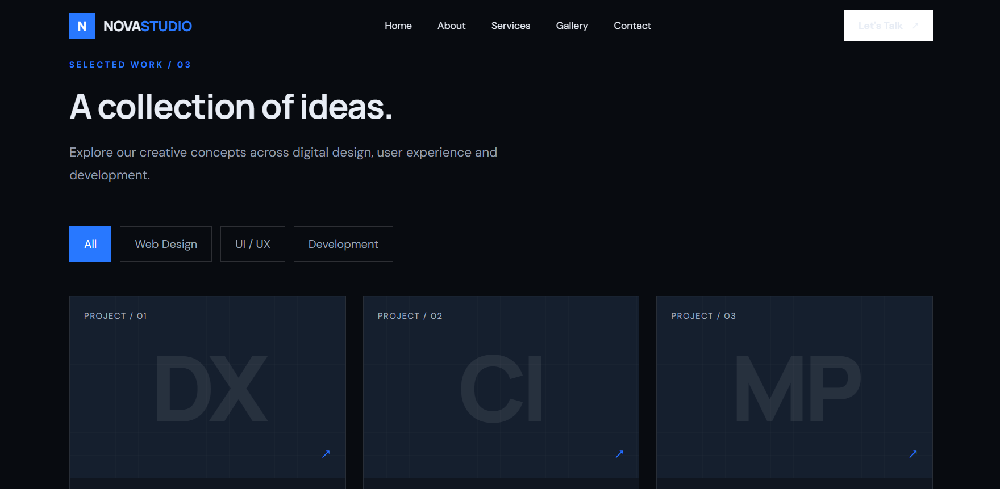
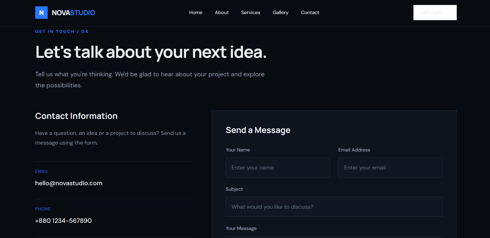

# NovaStudio — Creative Digital Agency

<p align="center">
  <strong>A Modern Digital Experience, Built with React.</strong>
</p>

<p align="center">
  A premium, responsive, multi-page creative agency website featuring a sophisticated dark interface, clean typography, and interactive components.
</p>

<p align="center">
  
  
  
  
</p>

<p align="center">
  <a href="https://github.com/Soumik-Riyan-Madhu/Ostad-Module-17-Assignment">Repository</a>
  ·
  <a href="#-screenshots">Screenshots</a>
  ·
  <a href="#-installation--setup">Installation</a>
</p>

---

## Overview

**NovaStudio** is a fictional creative digital agency website developed as part of the Ostad Full Stack Web Development with JavaScript (MERN) & AI course.

The project focuses on building a modern, multi-page frontend application using React.js and Tailwind CSS. It combines a premium dark visual identity with a structured layout, reusable components, and responsive design principles.

The website introduces the agency, showcases its services and selected projects, and provides a contact interface for potential clients.

## Features

- **Five Dedicated Pages** — Home, About, Services, Gallery, and Contact.
- **Client-Side Routing** — Seamless page navigation using React Router DOM.
- **Responsive Design** — Layouts adapted for desktop, tablet, and mobile devices.
- **Reusable Components** — Consistent UI elements through shared React components.
- **Interactive Navigation** — Mobile navigation menu with state management.
- **Portfolio Filtering** — Interactive category-based project filtering.
- **Contact Form** — Controlled form inputs, validation, and submission feedback.
- **Modern UI** — Premium dark theme, blue accent color, and refined typography.
- **Component-Based Architecture** — Organized and maintainable code structure.

## Screenshots

### Home Page


### About Page


### Services Page


### Gallery Page


### Contact Page


## Technology Stack

| Technology | Purpose |
|---|---|
| React.js | Frontend library |
| JavaScript (ES6+) | Application logic |
| Tailwind CSS | Styling and responsive layouts |
| React Router DOM | Client-side routing |
| Lucide React | Icon library |
| Vite | Development server and build tool |

## Project Structure

```text
react-website/
│
├── public/
│
├── screenshots/
│   ├── home.png
│   ├── about.png
│   ├── services.png
│   ├── gallery.png
│   └── contact.png
│
├── src/
│   ├── components/
│   │   ├── Button.jsx
│   │   ├── Footer.jsx
│   │   ├── Header.jsx
│   │   └── SectionTitle.jsx
│   │
│   ├── pages/
│   │   ├── Home.jsx
│   │   ├── About.jsx
│   │   ├── Services.jsx
│   │   ├── Gallery.jsx
│   │   └── Contact.jsx
│   │
│   ├── App.jsx
│   ├── index.css
│   └── main.jsx
│
├── .gitignore
├── index.html
├── package.json
├── package-lock.json
├── vite.config.js
└── README.md
```

## Installation & Setup

Follow these steps to run NovaStudio locally.

### Prerequisites

- Node.js (LTS version recommended)
- npm
- Git

### 1. Clone the Repository

```bash
git clone https://github.com/Soumik-Riyan-Madhu/Ostad-Module-17-Assignment.git
```

### 2. Navigate to the Project Directory

```bash
cd Ostad-Module-17-Assignment
```

### 3. Install Dependencies

```bash
npm install
```

### 4. Start the Development Server

```bash
npm run dev
```

Open the local URL displayed in your terminal to view the website.

## Available Scripts

| Command | Description |
|---|---|
| `npm run dev` | Starts the development server |
| `npm run build` | Creates an optimized production build |
| `npm run preview` | Previews the production build |

## Design Philosophy

NovaStudio follows a premium dark design direction built around:

- A near-black background with subtle surface variations.
- Electric blue accents for visual emphasis.
- Clear typographic hierarchy.
- Restrained borders and visual effects.
- Structured spacing and editorial-style layouts.

The goal is to create a professional digital agency experience without relying on excessive gradients, decorative effects, or generic card layouts.

## Project Notes

- This is a frontend-only demonstration project.
- The contact form currently provides client-side validation and submission feedback. It does not send emails or store submissions on a backend.
- Portfolio projects and agency information are demonstration content.
- No authentication or database integration is included.

## Assignment Information

| Field | Details |
|---|---|
| Course | Full Stack Web Development with JavaScript (MERN) & AI |
| Learning Platform | Ostad |
| Author | Soumik Riyan Madhu |
| Module | 17 — React.js Assignment |
| Project Name | NovaStudio |
| Project Type | Responsive Multi-Page Website |
| Repository | [Ostad-Module-17-Assignment](https://github.com/Soumik-Riyan-Madhu/Ostad-Module-17-Assignment) |

---

<p align="center">
  <strong>Developed by Soumik Riyan Madhu</strong>
  <br />
  <sub>Built with React.js, Tailwind CSS, and a focus on clean frontend development.</sub>
</p>
